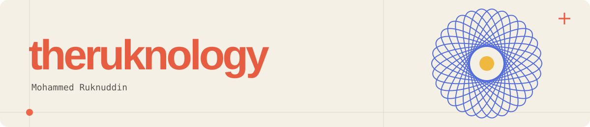
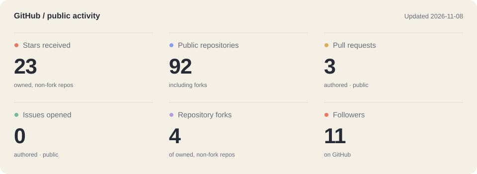

<h2>Hey, I’m Ruknuddin.</h2>

I write software in Go, Python, Rust and TypeScript. Lately that’s meant inference scheduling, tools for testing agents, and a chess trainer that picks puzzles based on how you play.

I like getting into the details of how things work, and spending just as much time on how they feel to use.

<a href="https://www.linkedin.com/in/theruknology/">LinkedIn</a> &nbsp; / &nbsp; <a href="https://www.youtube.com/@the_ruknology">YouTube</a> &nbsp; / &nbsp; <a href="https://www.instagram.com/the_ruknology/">Instagram</a>

<h2>Things I’ve been building</h2>
<table>
<tr>
<td width="50%" valign="top">
<h3><a href="https://github.com/theruknology/govessel">Vessel</a></h3>

An inference gateway that shares backend capacity between tenants. Weighted scheduling, token-cost estimates and deadline-aware admission.

Go · gRPC · Prometheus

</td>
<td width="50%" valign="top">
<h3><a href="https://github.com/theruknology/shahmat2">SHAHMAT</a></h3>

A chess tactics trainer with a Bayesian skill model for each theme. Selects puzzles as you play; runs entirely in the browser.

TypeScript · Vite

</td>
</tr>
<tr>
<td width="50%" valign="top">
<h3><a href="https://github.com/theruknology/agent-bazaar">bazaar</a></h3>

An x402 payment library and a simulated market of scripted agents. Payment budgets, replay protection and a double-entry ledger.

Go · x402

</td>
<td width="50%" valign="top">
<h3><a href="https://github.com/theruknology/peek">peek</a></h3>

Local semantic search over tmux scrollback. Find earlier terminal output with a natural-language query, then jump back to it.

Rust · SQLite · Ratatui

</td>
</tr>
</table>

Earlier-stage work

<a href="https://github.com/theruknology/agentprobe">AgentProbe</a> tests whether an LLM agent attempts prohibited tool calls in adversarial scenarios. Python CLI with mocked tools; the scenario set is still small.

<a href="https://github.com/theruknology/llm-rs">llm-rs</a> is a learning project: implementing transformer inference in Rust, targeting WebAssembly. Work in progress.

<h2>peek, in use</h2>

Search for an earlier error, then jump back to it in tmux.

Other tools used across these projects: Docker, Prometheus, Vite, sqlite-vec and Ratatui.

<h2>On GitHub</h2>
<picture>
  <source media="(prefers-color-scheme: dark)" srcset="assets/stats-dark.svg" />
  <source media="(prefers-color-scheme: light)" srcset="assets/stats-light.svg" />
  
</picture>

<picture>
  <source media="(prefers-color-scheme: dark)" srcset="https://raw.githubusercontent.com/theruknology/theruknology/output/github-contribution-grid-snake-dark.svg" />
  <source media="(prefers-color-scheme: light)" srcset="https://raw.githubusercontent.com/theruknology/theruknology/output/github-contribution-grid-snake.svg" />
  
</picture>

My GitHub contributions, with a snake. <a href="https://github.com/theruknology/theruknology/actions/workflows/main.yml">Updated every 12 hours.</a>

